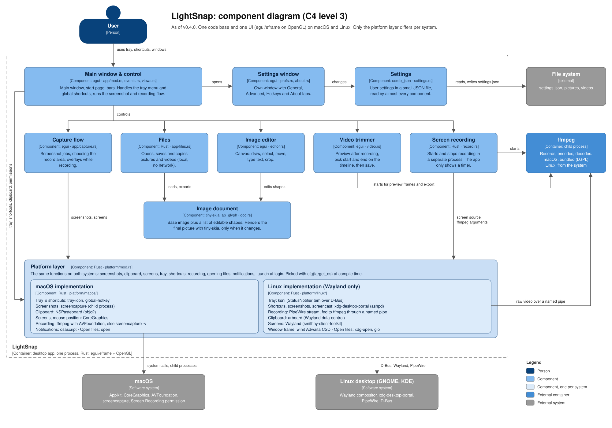

# LightSnap

A light screenshot and screen-recording app for the macOS menu bar and Linux desktops.
Nothing is uploaded: captures are saved locally and copied to the clipboard.


https://github.com/user-attachments/assets/b8232ba4-2def-4e8c-8b16-cafa73b4fcb8

https://github.com/user-attachments/assets/46ae8e39-80f6-49de-8999-1297302c81de

## Why LightSnap

I am a product owner at a software company. Every day I take what feels like a million
screenshots and screen recordings: to specify tickets, answer customer requests or
explain things to colleagues. So I want a tool that creates as little extra work as
possible.

I don't want to search for the screenshot I just took. It should be in the clipboard
right away, so I can paste it into the chat. I also don't want to press Cmd+C after I
annotate it. Every change should update the clipboard, so I can paste the result
wherever it needs to go. And videos need to be crisp and small at the same time, so I
can send them without waiting.

Very few tools do both screenshots and screen recordings. Even fewer save me clicks or
are free and open source. Many also get worse over time: accounts, cloud uploads,
subscriptions, ads, and more memory with every update. When my last tool started to
leak several GB of memory, I built my own.

Now I have exactly the simple, lightweight tool I need every day. Maybe you will find
it useful too.

- **Fewer clicks:** unlike the tools built into macOS and Linux, LightSnap copies every
  capture and every edit to the clipboard right away. No extra copy step.
- **2 in 1:** take and annotate screenshots, and record your screen, in one tool.
- **Small videos:** you choose the frame rate and quality. QuickTime and other built-in
  recorders make huge files that take ages to send. LightSnap keeps them small.
- **Fast and light:** built for speed. While it waits in the menu bar, it uses 0% CPU
  and about 100 MB of memory (M1 Pro, macOS 27).
- **Tiny download:** 6.4 MB on macOS, 15 MB installed, ffmpeg included.
- **No account, no cloud, no ads, no subscription.** LightSnap makes no network
  connections. Your captures stay on your computer.
- **Simple:** no frills, no setup. Pick an area, annotate, done.
- **Yours to keep:** MIT license. If the project ever goes a way you don't like, fork it.

## Requirements

- **Mac:** Apple Silicon and macOS 27 or later
- **Linux:** a desktop running Wayland (see [Linux](#linux))

## Install (macOS)

The app is not notarized by Apple (that needs a paid developer account), so macOS blocks it
the first time:

1. Download `LightSnap-<version>.zip` from
   [Releases](https://github.com/pschu13r/lightsnap/releases), unzip it and move
   `LightSnap.app` to **Applications**.
2. Open it. macOS says it cannot check the app. Click **Done** (not "Move to Trash").
3. Go to **System Settings › Privacy & Security**, scroll down to the message about LightSnap
   and click **Open Anyway**. Confirm with your password or Touch ID.
4. Allow **Screen & System Audio Recording** when LightSnap asks, then quit and reopen it.

Instead of steps 2 and 3, you can remove the download mark in Terminal:

```bash
xattr -dr com.apple.quarantine /Applications/LightSnap.app
```

To check that your copy was built by Philipp Schuler, see [Signing](#signing).

## Build (macOS)

Needs Rust (https://rustup.rs) and the Xcode command line tools. `bundle.sh` also needs
cargo-about: `cargo install --locked --features cli cargo-about`.

```bash
./scripts/build-ffmpeg.sh  # once: build the ffmpeg that ships with the app (a few minutes)
cargo run                  # run from source
./scripts/bundle.sh        # build dist/LightSnap.app and dist/LightSnap-<version>.zip
```

Video recording, trimming and GIF export use ffmpeg. `scripts/build-ffmpeg.sh` downloads the
official source, checks its signature and builds an LGPL-only ffmpeg (no x264) that encodes
with Apple's hardware encoder. `bundle.sh` puts it into the app. When run from source,
LightSnap uses this build, or else an ffmpeg from Homebrew.

## Signing

Releases by Philipp Schuler are signed with a self-signed certificate:

    LightSnap Dev, SHA-1 d51bd93470b3635b5b854c8edb609a7709b3f3a6

To check a copy, run `codesign -d -r- LightSnap.app`. It shows the SHA-1 as
`certificate leaf = H"…"`.

To sign your own builds, see [Signing](CONTRIBUTING.md#signing-macos) in CONTRIBUTING.

## Linux

LightSnap runs on Wayland desktops. X11 is not supported. It is tested on GNOME and KDE
Plasma.

Wayland lets no app read the screen or catch keys on its own, so LightSnap asks the desktop
through its portals. Your desktop asks you once for each:

- **Screenshots**: full-screen and timed captures. GNOME can ask only while LightSnap's window
  is in front, so LightSnap shows a note with an **Allow…** button.
- **Screen sharing**: for recordings. Choose the screen and keep **Remember this selection**.
- **Global shortcuts**: confirm the keys. To change them later, use your desktop's settings
  (GNOME: **Settings › Apps › LightSnap**).

Capture Area and Capture Window use your desktop's own screenshot picker. While recording,
LightSnap has no window: stop or pause it from the tray icon or with the shortcut. On KDE
Plasma, Sway, Hyprland and COSMIC a red frame shows the recorded area, as on macOS (orange
while paused). GNOME does not let apps draw such a frame.

Needs:

- xdg-desktop-portal with a backend for your desktop (GNOME 48+ or KDE Plasma 6 for global
  shortcuts), PipeWire, and ffmpeg with x264 (`sudo apt install ffmpeg`).
- GNOME shows the tray icon with the AppIndicator extension (Ubuntu has it; on Fedora install
  "AppIndicator and KStatusNotifierItem Support").

Install: download `LightSnap-<version>-linux-<arch>.tar.gz` from
[Releases](https://github.com/pschu13r/lightsnap/releases), unpack it anywhere and start
`lightsnap`. On first start it adds itself to your app list (`~/.local/share/applications`).

Build from source (Ubuntu/Debian package names):

```bash
sudo apt install build-essential pkg-config clang libclang-dev libpipewire-0.3-dev \
  libspa-0.2-dev libwayland-dev libxkbcommon-dev libdbus-1-dev ffmpeg
cargo run                      # run from source
./scripts/bundle-linux.sh      # build dist/LightSnap-<version>-linux-<arch>.tar.gz
```

The GitHub workflow `.github/workflows/linux.yml` builds the packages for x86_64 and arm64.

## Architecture

LightSnap is one Rust app with one UI on both systems: egui/eframe, drawn with OpenGL.
Only `src/platform/` has its own code for macOS and for Linux (tray, shortcuts, screenshots,
clipboard, recording). Video work runs in an ffmpeg child process.



`scripts/architecture-diagram.py` draws this diagram. Update it when the module layout changes.

[docs/recording.md](docs/recording.md) shows step by step how a recording runs on macOS
and on Linux, and why it works that way.

## Disclaimer

LightSnap is a free, non-commercial hobby project under the MIT License.
It is provided "as is", without warranty of any kind. Use it at your own risk.
To the extent permitted by law, the author is not liable for any damage or loss,
including lost data, arising from the use of or inability to use this software.
There is no support and no promise of updates or fixes.

You are responsible for how you use it. Recording other people's screens,
calls or voices may require their consent where you live.

## License

MIT, see [LICENSE](LICENSE).

The app also ships ffmpeg (LGPL 2.1+) and the code of many Rust crates. Their licenses, the
ffmpeg source, its build options and our patch are listed in
[THIRD_PARTY_NOTICES.txt](THIRD_PARTY_NOTICES.txt). `scripts/notices.sh` writes that file from
`Cargo.lock` and the ffmpeg build; `bundle.sh` runs it and copies it, `LICENSE`, the patch and
the ffmpeg build script into `LightSnap.app/Contents/Resources/`.

On Linux, ffmpeg is not shipped. `scripts/bundle-linux.sh` writes the crate licenses for the
Linux build into the package as `THIRD_PARTY_NOTICES.txt`.
