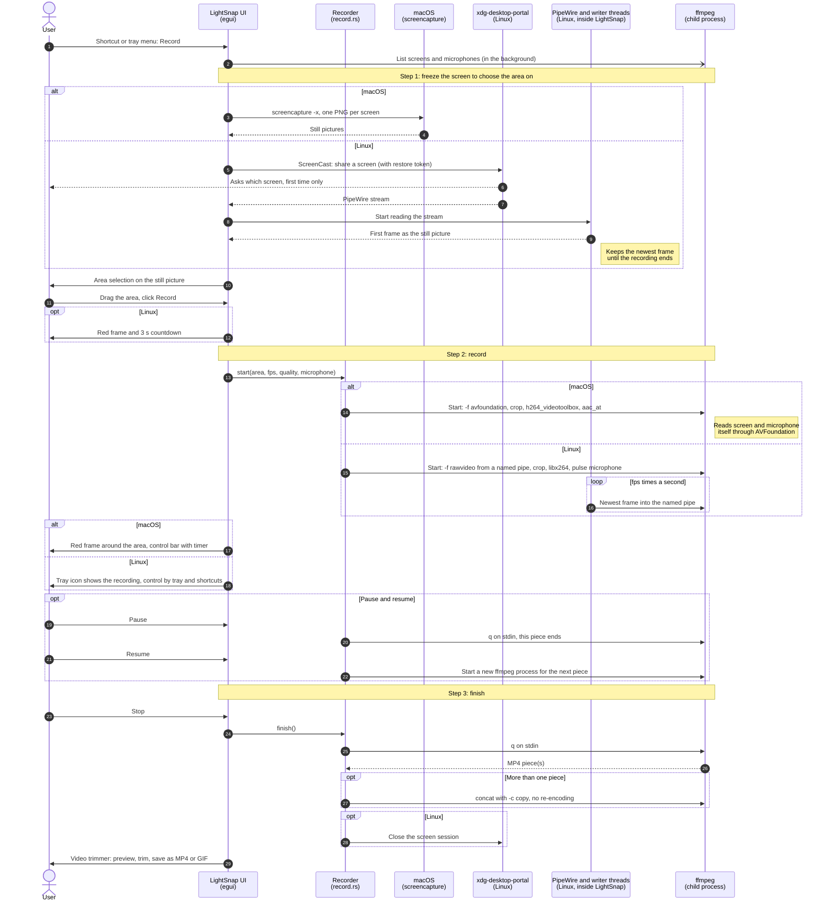

# Screen recording on macOS and Linux

How a recording runs, from the shortcut to the video trimmer. Both systems share the UI,
the recorder and ffmpeg as the encoder. They differ in how LightSnap gets at the screen:
on macOS ffmpeg reads it itself, on Linux (Wayland) LightSnap gets it from the desktop and
hands it to ffmpeg.

See [README: Architecture](../README.md#architecture) for the component diagram.

Without ffmpeg, macOS records with its own `screencapture -v` (no pause, no frame rate or
quality settings). Linux cannot record without ffmpeg.

## Why it works this way

**Both systems**

- **ffmpeg runs as its own process.** The app only shows a timer and stays small and idle.
  ffmpeg is called as a separate program and not linked, so LightSnap can stay MIT.
- **One encode path.** ffmpeg crops and encodes on both systems, so the recorder code is the
  same. Only the input and the encoder names differ.
- **Stop with `q` on stdin.** ffmpeg then stops cleanly and finishes the MP4 file. After 8 s
  without an exit, the recorder kills it.
- **Pause makes pieces.** ffmpeg cannot pause a recording. Each pause ends the process and
  resume starts a new one. At the end the pieces are joined without re-encoding. Each piece
  loses about half a second to ffmpeg's startup.
- **The area is chosen on a still picture.** The selection works across several screens,
  and the area can be dragged to another screen.
- **ffmpeg's error output goes to a log file.** A full pipe could stall a long recording.
- **Frame rate and quality are settings.** Built-in recorders make huge files that take
  ages to send. LightSnap keeps them small.

**macOS**

- **ffmpeg reads the screen through AVFoundation.** It is ffmpeg's screen and microphone
  input on macOS. The cursor and clicks come from AVFoundation too.
- **LightSnap ships its own ffmpeg, built under the LGPL.** Ready-made macOS builds almost
  always contain x264 and are GPL. The own build has only what LightSnap needs: AVFoundation
  input, Apple's hardware H.264 encoder and Apple's AAC encoder. That keeps it small.
- **A patch fixes lost sound.** ffmpeg's AVFoundation input keeps only one audio frame.
  While a video frame is read, newer audio overwrites older audio, so recordings lost about
  15 % of their sound. The patch queues the audio frames instead.
- **The red frame is four thin windows outside the area.** One see-through window over the
  area would be recorded as black.

**Linux (Wayland only)**

- **Wayland only, no X11.** X11 is de facto replaced: Ubuntu, Fedora and KDE use Wayland by
  default. Supporting X11 too would double the platform code for a shrinking share of desktops.
- **Screen access goes through the ScreenCast portal.** Wayland lets no app read the screen.
  The portal asks the person once; the restore token remembers the answer.
- **LightSnap reads PipeWire itself.** The ffmpeg in current Ubuntu cannot read PipeWire.
- **Frames go to ffmpeg through a named pipe, at a steady rate.** The compositor sends a
  frame only when the screen changes. The writer repeats the newest frame `fps` times a
  second, so the video has an even frame rate.
- **The screen stays shared from the still picture to the end of the recording.** The person
  picks the screen once, and the recording starts at once.
- **The area is chosen in the full-screen main window, with a countdown.** Wayland can
  neither place windows nor reliably put a new one in front. For the same reason there is
  no frame or control bar while recording: the tray and the shortcuts control it.
- **ffmpeg comes from the system.** LightSnap does not ship it on Linux, so encoding with
  libx264 is fine. Microphones come from PulseAudio or PipeWire's Pulse server.
